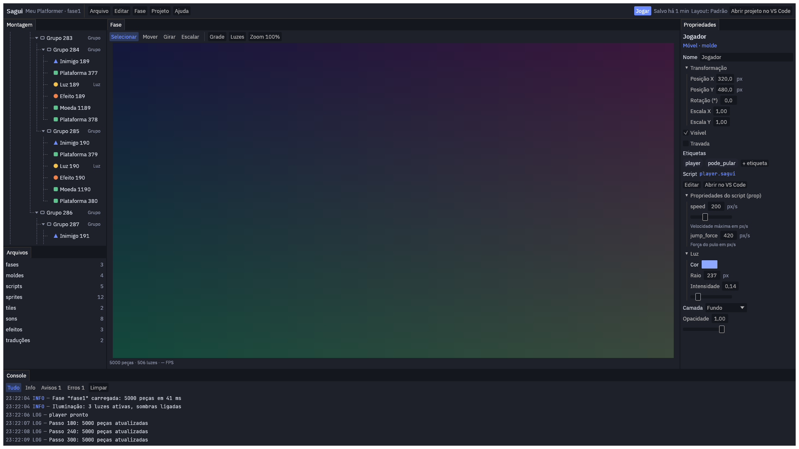
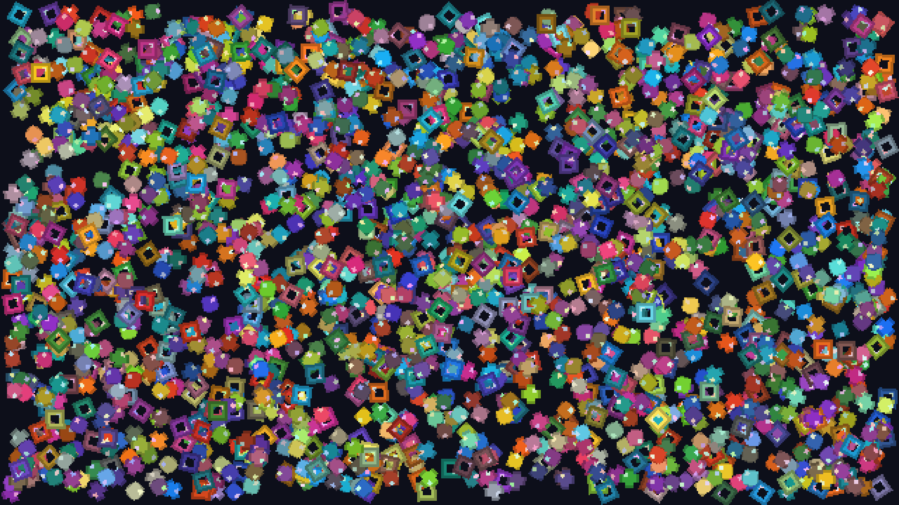
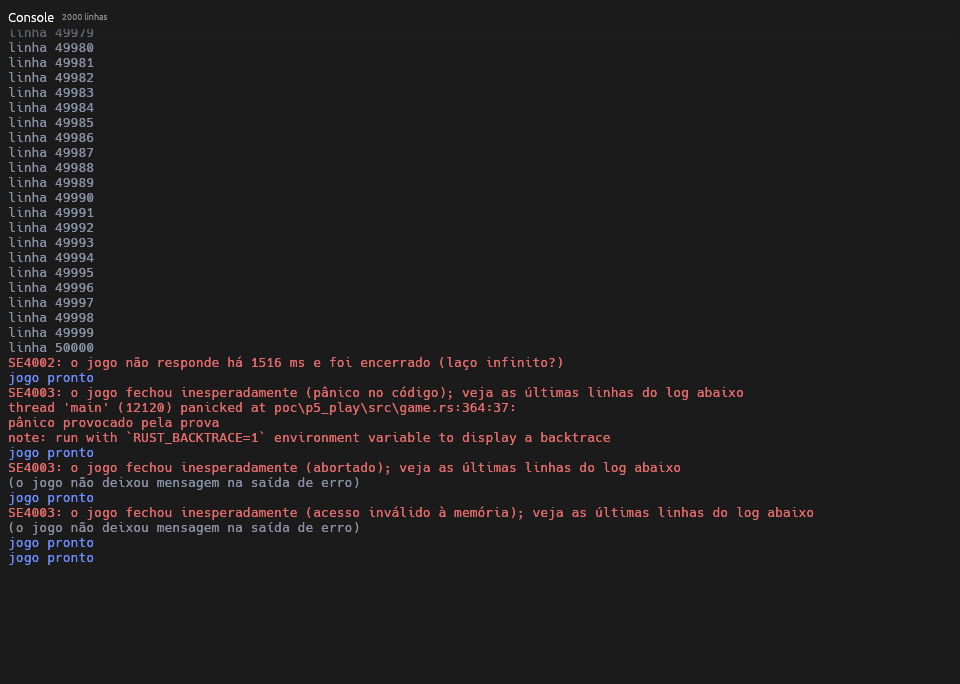

+++
title = "Devlog da etapa 0: provar o difícil antes de construir"
date = 2026-10-15
description = "Cinco provas pequenas atacaram os maiores riscos antes de a engine começar: o pulo, o editor com 5 000 peças, a velocidade da linguagem, os gráficos em computadores modestos e o jogo separado do editor."

[extra]
stage = "0"
+++

*Os números são provisórios: medi no meu PC, e os oficiais vão sair de um
notebook modesto que ainda vai chegar.*

A {{ <marca /> }} é uma engine de jogos 2D, ou seja, um programa para criar
jogos. Ela vem com uma linguagem própria, a {{ <linguagem /> }}, que serve para
dizer como cada coisa do jogo se comporta. Antes de construir a engine de
verdade, fiz a etapa 0: cinco testes pequenos, que chamo de provas, cada um
atacando um dos maiores riscos do projeto. O código das provas vai para o
lixo. O que fica é o aprendizado: os números medidos, o que funcionou e o que
mudou no plano.

Faço a {{ <marca /> }} com a ajuda do Claude, uma inteligência artificial: ele
escreve o código e faz as medições, e eu reviso, jogo e decido o que entra. As
cinco provas ficaram prontas entre 11 e 12 de outubro de 2026.

## Por que "provisório"

As metas da {{ <marca /> }} valem para uma máquina modesta: um notebook de
2018, com processador i5 e sem placa de vídeo separada. Se roda bem nele, roda
bem na maioria dos computadores. Esse notebook ainda não chegou, então medi no
meu PC, que é bem mais rápido. Para compensar, no PC uma prova só conta como
"provavelmente passa" se usar no máximo metade do tempo permitido.

Duas palavras aparecem bastante:

- **Passo:** o jogo recalcula o mundo (quem se mexeu, quem bateu em quem) 60
  vezes por segundo, sempre no mesmo ritmo. Cada recálculo é um passo.
- **Quadro:** cada imagem desenhada na tela. A tela mostra 60 imagens por
  segundo, então cada uma precisa ficar pronta em cerca de 16 milésimos de
  segundo (ms). Se uma imagem demora mais, a tela "engasga" por um instante.

## As cinco provas

### 1. O pulo

**O risco:** um jogo de plataforma vive do pulo. Além disso, quero que o mesmo
jogo, jogado apertando os mesmos botões, termine exatamente igual em qualquer
computador. Isso permite gravar uma partida e assistir de novo, salvar no meio
e, um dia, jogar online.

**O resultado:** uma partida gravada de 60 segundos termina igual no Windows,
no Linux (outro sistema, como o Windows) e no navegador, com 60 ou com 120
passos por segundo. Salvar no meio, fechar o programa e continuar em outro
também dá o mesmo final. Os três jeitos de pular (Precisa, Suave e Pesada)
foram ajustados jogando. Calcular os movimentos e as batidas de 200 objetos
leva 0,023 ms por passo, e o limite no PC era 1 ms.

### 2. O editor com 5 000 peças

**O risco:** o editor, que é o programa onde a pessoa monta o jogo, ficar
lento quando o cenário tem muita coisa.

**O resultado:** testei com 5 000 peças, e cada plataforma, inimigo ou moeda
do cenário é uma peça. Rolando a lista, escolhendo, arrastando valores,
digitando e abrindo grupos, 99% das imagens ficaram prontas em menos de 2 ms,
contra os 16 ms permitidos. Nenhuma passou de 33 ms, o tempo de duas imagens.

### 3. A velocidade da linguagem

**O risco:** a {{ <linguagem /> }} ser lenta demais para jogos com muita coisa
acontecendo ao mesmo tempo.

**O resultado:** 5 000 peças, cada uma com o seu pequeno programa, levam
0,29 ms por passo, e a meta é 4 ms. Existe um "vigia" que interrompe um
programa preso num ciclo sem fim, como um "repita para sempre" escrito por
engano, para o jogo não congelar. Ele não deixou nada mais lento, então fica
sempre ligado. No navegador, a linguagem leva 1,5 vez o tempo do programa
instalado no computador, o que basta para o site onde se vai aprender
{{ <linguagem /> }}.

### 4. Gráficos em computadores modestos

**O risco:** o modo de compatibilidade ser lento demais. É o jeito de desenhar
que funciona em placas de vídeo antigas e no navegador.

**O resultado:** 2 000 sprites, que são as imagens de personagens e objetos,
são desenhados com um único pedido à placa de vídeo, o que poupa muito tempo.
No Chrome, em 3 600 imagens seguidas (um minuto), nenhuma atrasou. A medida no
programa instalado fica para o notebook: no meu PC, o monitor está ligado na
outra placa de vídeo, e a imagem faz um desvio que o notebook não tem.

### 5. Jogar sem derrubar o editor

**O risco:** um erro no jogo fechar o editor junto e levar o trabalho de quem
está criando.

**O resultado:** quando a pessoa aperta Jogar, o jogo abre como um programa
separado, que conversa com o editor. As 13 metas foram cumpridas:

- **Jogo travado:** o editor percebe em 1,5 segundo e fecha só o jogo.
- **Jogo que quebra:** o editor percebe em menos de um décimo de segundo e
  mostra uma mensagem com o motivo.
- **Reabrir:** o jogo volta em 10 ms.
- **Mensagens do jogo:** 10 000 mensagens por segundo chegam ao painel do
  editor sem perder nenhuma.
- **20 quebras seguidas:** nenhuma cópia do jogo ficou esquecida rodando, e o
  editor não passou a ocupar mais memória.

## O que deu errado (e como resolvi)

- **O vazamento que não existia.** Parecia que o editor ocupava um pouco mais
  de memória a cada vez que o jogo quebrava, o que com o tempo deixaria o
  computador lento. Depois de muito procurar, o erro estava na conta que mede
  a memória: ela somava uma parte duas vezes. Com a conta certa, a memória
  ficou estável.
- **O editor sem letras.** Na prova 5, a foto da tela que o teste tira sozinho
  mostrou o editor sem nenhum texto: faltavam os arquivos com o desenho das
  letras. Os testes automáticos não pegaram, porque conferem os botões e os
  textos pela descrição da tela, e não pela imagem. A lição: olhar também as
  fotos, não só os testes.
- **O engasgo de 50 ms.** Na prova do editor, uma das imagens levava 50 ms,
  três vezes o tempo normal, e a tela engasgava por um instante. Acontecia uma
  vez só, sempre logo depois de a janela abrir. Primeiro desconfiei das letras,
  que são preparadas na primeira vez em que aparecem. Depois de onze rodadas de
  teste, tudo indica que o engasgo era a animação de abertura de janela do
  Windows, e não o editor. A solução foi esperar 1 segundo com a janela aberta
  antes de começar a medir.
- **O código de fora reprovado.** O editor usava um código pronto, feito por
  outras pessoas, para organizar os painéis em abas. Ele dependia de outro
  código que ninguém mantém mais, e foi reprovado na checagem automática que
  faço em tudo o que vem de fora. Troquei por outro que faz quase tudo igual.
- **O computador de testes sem espaço.** A cada mudança, os testes rodam
  sozinhos num computador do GitHub, o site onde fica o código. Esse
  computador ficou sem espaço em disco. Liberei espaço apagando programas que
  o projeto não usa, sem deixar os testes mais lentos. Também cortei o tempo
  gasto, porque o plano gratuito dá 2 000 minutos de testes por mês.
- **A conta do travamento.** O plano dizia que o editor perceberia um jogo
  travado entre 1,5 e 1,75 segundo. O certo é entre 1,25 e 1,5 segundo, porque
  o jogo avisa que está vivo a cada quarto de segundo, e o último aviso pode
  ter saído um pouco antes de ele travar. Disso saiu uma regra para a engine:
  esse aviso vai vir de uma parte do programa que só cuida disso, para que
  carregar uma fase grande do jogo não pareça um travamento.

## O que falta

- **O notebook:** os números oficiais de todas as provas, a prova 4 no
  programa instalado e a minha conferência à mão, no Chrome e no Firefox.
- **Metas folgadas demais:** quase toda meta sobrou mais de 80% no PC. Vou
  revê-las depois dos números do notebook, para não apertar nem afrouxar às
  cegas.

Desde a noite de 12 de outubro, os testes automáticos também rodam num Mac, a
cada mudança que entra.

Com isso, a etapa 0 está fechada até o notebook chegar. A etapa 1 começa do
zero, com o desenho geral da engine já decidido e com o que aprendi aqui:
primeiro escrevo o que cada parte precisa fazer, depois vem o código, e cada
entrega só termina com os testes passando.
